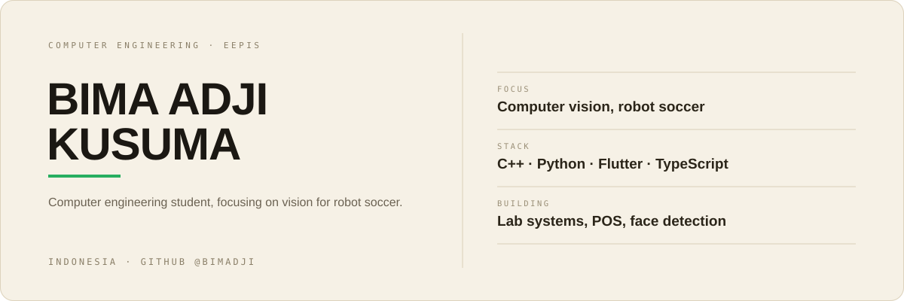

  

<b>Hey, I'm Bima.</b>

Computer engineering student at EEPIS. I build vision software for the middle-size robot soccer team, and apps that get used for real work.

  <a href="https://github.com/bimadji?tab=repositories">Repositories</a> ·
  <a href="https://www.linkedin.com/in/bima-adji">LinkedIn</a>

---

## Selected work

- [pos-app-flutter](https://github.com/bimadji/pos-app-flutter) — Realtime point of sale: customers order from the table, cashier confirms over WebSocket. `Flutter` `Node.js` `MySQL`
- [Monocular-Distance-Estimation---YoloV8](https://github.com/bimadji/Monocular-Distance-Estimation---YoloV8) — Distance to an object from one webcam, calibrated once with the pinhole model. `C++` `OpenCV` `YOLOv8`
- [LabManage](https://github.com/bimadji/LabManage) — Facility booking, component inventory, and attendance for the PENS robotics lab. `React` `Express` `Supabase`
- [Sistem-Pendataan-UKM-Desa---Flutter](https://github.com/bimadji/Sistem-Pendataan-UKM-Desa---Flutter) — Village SME data collection, port of the SIPUDESA web app. `Flutter` `SQLite`
- [oamp-face-camera](https://github.com/bimadji/oamp-face-camera) — Camera app built on YOLOv5 detection, with a GUI and audio feedback per level. `Python` `YOLOv5`
- [MakanApa](https://github.com/Ivanadrian31/MakanApa) — Terminal picker for what to eat, with budget filters, tags, and history. `Shell` `bats`
- [dealcompass](https://github.com/feboyfierlyan/dealcompass) — Sales decision workspace on context graphs, built with the team at Hackathon PENS 2026. `Python`

---

## Stack

  
  
  
  
  
  
  
  

---

## Now

- Developing [MakanApa](https://github.com/Ivanadrian31/MakanApa), a terminal picker for what to eat
- Keeping [LabManage](https://github.com/bimadji/LabManage) running for the robotics lab: bookings, inventory, attendance

---

## Contact

Email: [bimaadjikusuma@gmail.com](mailto:bimaadjikusuma@gmail.com)
