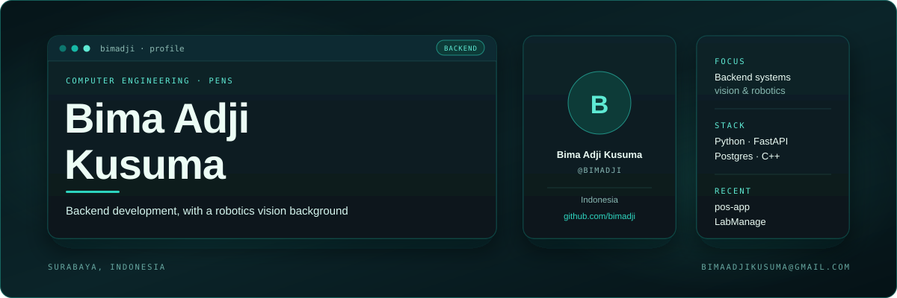
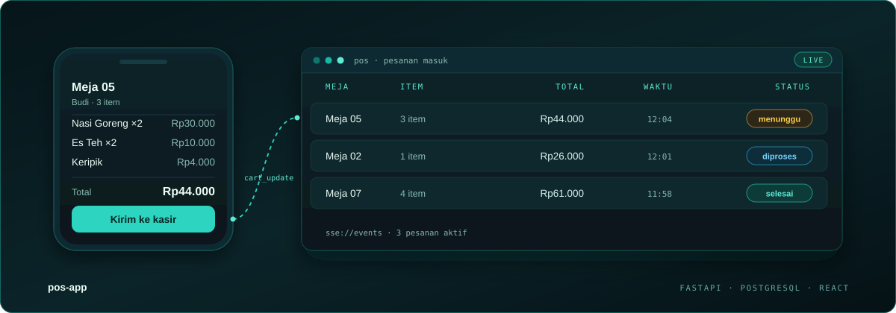
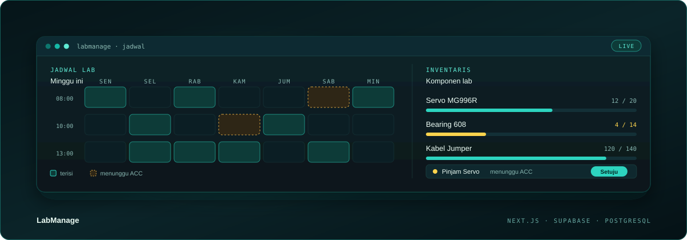
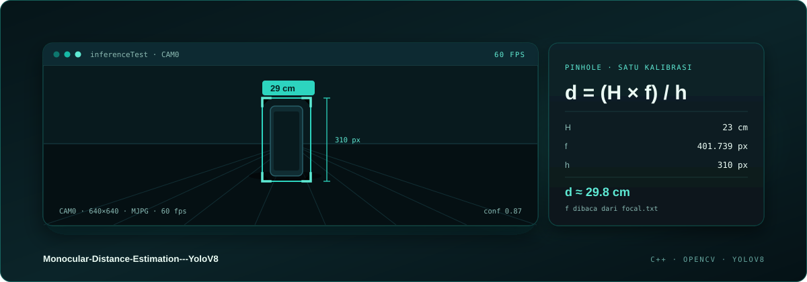
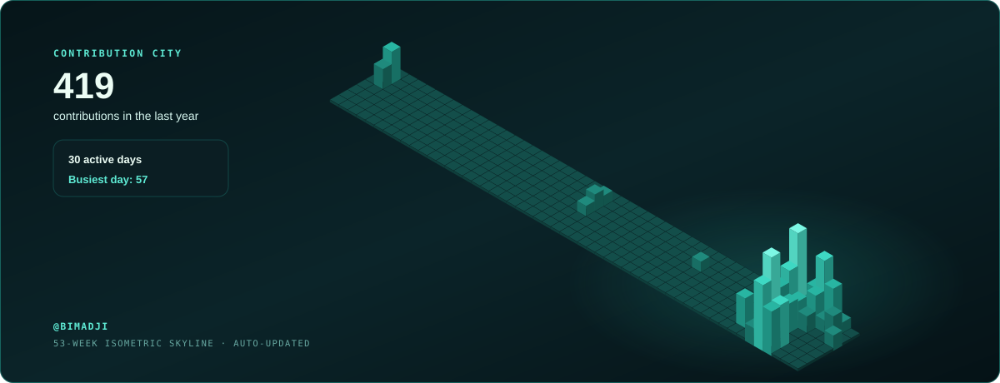

  <picture>
    <source media="(prefers-color-scheme: light)" srcset="assets/code-pet-light.svg">
    
  </picture>

Grows with my daily commits: a 13-week streak fills the meter, active weeks unlock new stages, and two quiet weeks let it rest.

  

<b>Hey, I'm Bima.</b>

Computer engineering student at PENS focusing on backend systems. Former member and Vision Division Coordinator at ERSOW (EEPIS Robot Soccer on Wheeled), with a background in robotics and computer vision.

  <a href="https://github.com/bimadji?tab=repositories">Repositories</a> ·
  <a href="https://www.linkedin.com/in/bima-adji">LinkedIn</a>

---

## Selected work

### [pos-app](https://github.com/bimadji/pos-app) · [Live demo](https://bimadji.github.io/pos-app/)

Multi-tenant dine-in POS for 10-25 table cafes with QR table ordering, atomic stock updates, live kitchen streams via Server-Sent Events, 58mm thermal receipts, and shift cash reconciliation. `FastAPI` `PostgreSQL` `Python` `React` `Tailwind CSS`

### [LabManage](https://github.com/bimadji/LabManage) · [Live app](https://lab-manage-lilac.vercel.app)

Facility scheduling, shared vs. team hardware inventory, and weekly research attendance for the PENS Robotics Lab on Supabase Postgres with row-level security. `TypeScript` `Next.js` `React` `Supabase` `PostgreSQL`

### [Monocular-Distance-Estimation---YoloV8](https://github.com/bimadji/Monocular-Distance-Estimation---YoloV8)

Object distance estimation from a single webcam using YOLOv8 bounding boxes and a one-shot calibrated pinhole camera model in C++. `C++` `OpenCV` `YOLOv8`

### More work

- [QueueClaim](https://github.com/bimadji/QueueClaim) - Event-driven userscript that claims real-time consultation-queue sessions automatically using DOM observation and operational guardrails. `JavaScript`
- [dealcompass](https://github.com/feboyfierlyan/dealcompass) - Decision workspace on context graphs for deal acceleration, built during Hackathon PENS 2026. `Python`
- [uangku](https://github.com/bimadji/uangku) - Offline-first personal finance tracking for Android with local parsing and budgeting tools. `Flutter` `Dart`
- [organize](https://github.com/Ivanadrian31/organize) - Shell utility with automated test suites that sorts directories into category folders by file extension. `Shell` `bats`
- [Sistem-Pendataan-UKM-Desa---Flutter](https://github.com/bimadji/Sistem-Pendataan-UKM-Desa---Flutter) - Village SME survey and registry app (SIPUDESA) backed by local SQLite and CSV import, paired with a [PHP/MySQL web portal](https://github.com/bimadji/Sistem-Pendataan-UKM-Desa). `Flutter` `SQLite` `PHP`
- [oamp-face-camera](https://github.com/bimadji/oamp-face-camera) - Camera utility built on YOLOv5 face detection with GUI controls and per-level audio feedback. `Python` `YOLOv5`
- [MakanApa](https://github.com/Ivanadrian31/MakanApa) - Lightweight Bash CLI to pick daily meals with budget filters, tags, and history tracking. `Shell`

---

## The city I built this year

  <picture>
    <source media="(prefers-color-scheme: light)" srcset="assets/contribution-city-light.svg">
    
  </picture>

Every block is a day from the past year; taller towers mark higher contribution volume.

---

## Stack

  
  
  
  
  
  
  
  
  

---

## Now

- Expanding [pos-app](https://github.com/bimadji/pos-app) with asynchronous kitchen events and order analytics
- Maintaining [LabManage](https://github.com/bimadji/LabManage) for the PENS Robotics Lab
- Refining event-driven DOM observers and safety guardrails in [QueueClaim](https://github.com/bimadji/QueueClaim)

---

## Contact

Interested in working together? Let's talk.

[bimaadjikusuma@gmail.com](mailto:bimaadjikusuma@gmail.com) · [LinkedIn](https://www.linkedin.com/in/bima-adji)
