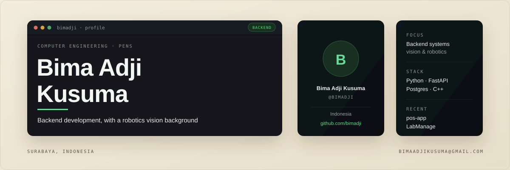
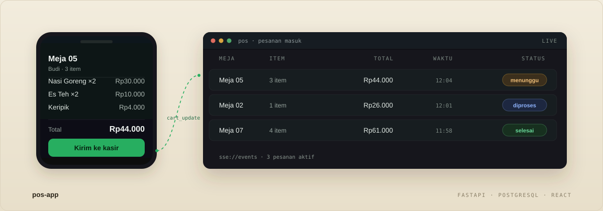
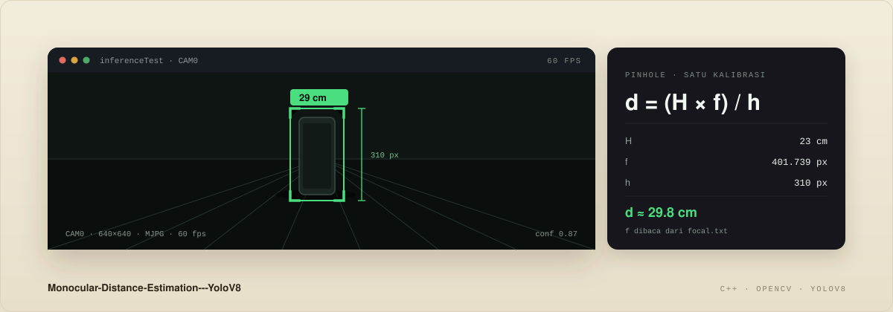
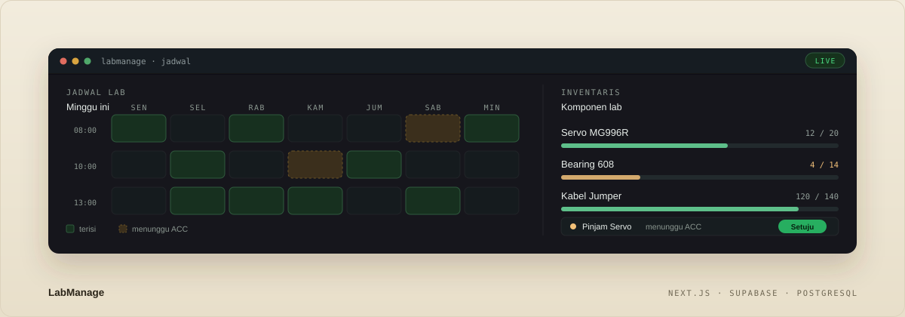

  

<b>Hey, I'm Bima.</b>

Computer engineering student at PENS focusing on backend systems. Former member and Vision Division Coordinator at ERSOW (EEPIS Robot Soccer on Wheeled), with a background in robotics and computer vision.

  <a href="https://github.com/bimadji?tab=repositories">Repositories</a> ·
  <a href="https://www.linkedin.com/in/bima-adji">LinkedIn</a>

---

## Selected work

### [pos-app](https://github.com/bimadji/pos-app)

Multi-tenant dine-in POS with QR ordering, atomic stock updates, and live kitchen streams via Server-Sent Events. `FastAPI` `PostgreSQL` `Python` `React`

### [Monocular-Distance-Estimation---YoloV8](https://github.com/bimadji/Monocular-Distance-Estimation---YoloV8)

Distance estimation from a single webcam using YOLOv8 bounding boxes and a calibrated pinhole camera model in C++. `C++` `OpenCV` `YOLOv8`

### [LabManage](https://github.com/bimadji/LabManage)

Facility scheduling, hardware inventory, and research attendance for the PENS robotics lab on Supabase Postgres with row-level security. `TypeScript` `Next.js` `Supabase` `PostgreSQL`

### More work

- [uangku](https://github.com/bimadji/uangku) - Offline-first personal finance tracking for Android with local parsing and budgeting tools. `Flutter` `Dart`
- [organize](https://github.com/Ivanadrian31/organize) - Shell utility that sorts directories into category folders by file extension. `Shell` `bats`
- [Sistem-Pendataan-UKM-Desa---Flutter](https://github.com/bimadji/Sistem-Pendataan-UKM-Desa---Flutter) - Village SME survey and data collection tool backed by SQLite. `Flutter` `SQLite`
- [oamp-face-camera](https://github.com/bimadji/oamp-face-camera) - Camera utility built on YOLOv5 face detection with audio cue feedback. `Python` `YOLOv5`
- [dealcompass](https://github.com/feboyfierlyan/dealcompass) - Decision workspace on context graphs, built during Hackathon PENS 2026. `Python`
- [MakanApa](https://github.com/Ivanadrian31/MakanApa) - Terminal picker for daily meals with budget filters and history. `Shell`

---

## Stack

  
  
  
  
  
  
  
  
  

---

## Now

- Expanding [pos-app](https://github.com/bimadji/pos-app) with asynchronous kitchen events and order analytics
- Maintaining [LabManage](https://github.com/bimadji/LabManage) for the PENS robotics lab

---

## Contact

Interested in working together? Let's talk.

[bimaadjikusuma@gmail.com](mailto:bimaadjikusuma@gmail.com) · [LinkedIn](https://www.linkedin.com/in/bima-adji)
